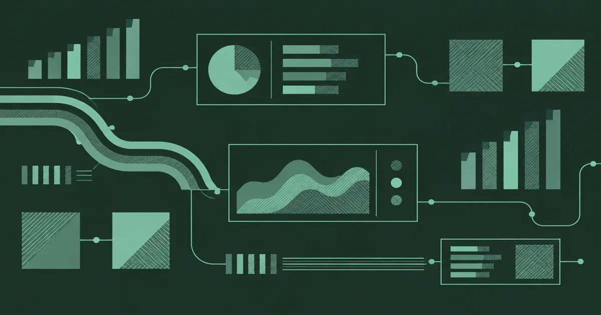
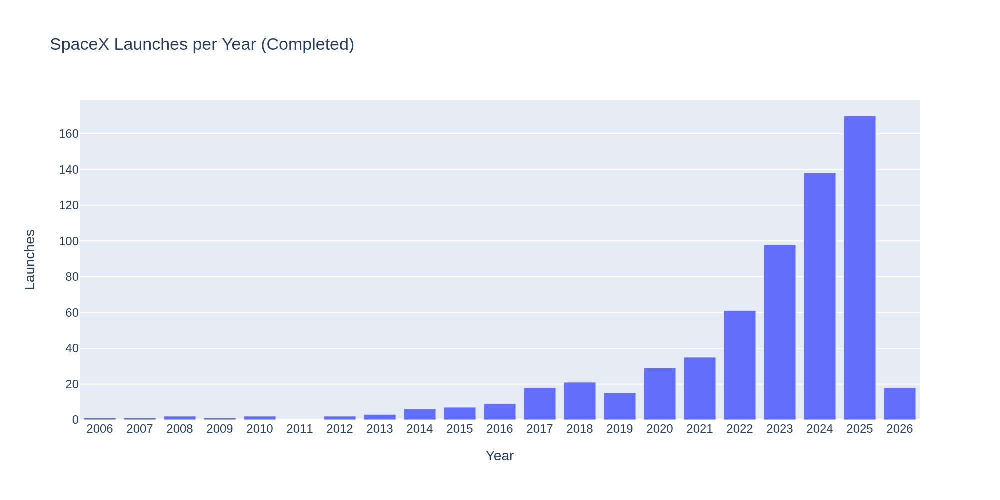
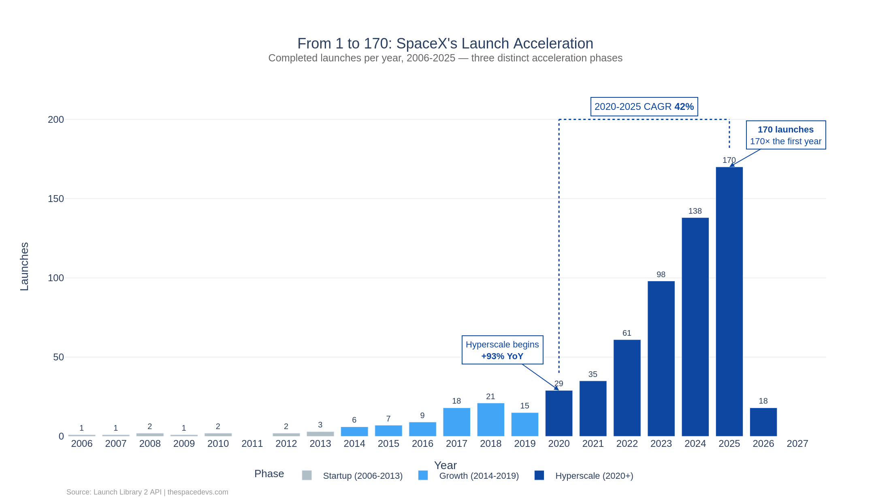

# Choosing a chart your CFO will read
<!--
Primary: choosing a chart
Secondary: chart annotation; chart composition
Intent: demonstrate a visual editing process with real tutorial assets.
-->

!!! warning "Sample post"
    This is a demo post by a fictional sample author. No CFO interview or business outcome is being claimed.

Choosing a chart gets easier when the question is specific. "How did annual launch volume change?" needs a time comparison. "Which business unit explains the variance?" needs a contribution comparison. Start with the question a reader must answer, then choose the display that makes that comparison visible.

<!-- more -->

{ width="1200" height="630" }

## Before: a chart with an unfinished brief

The [launch-cadence tutorial](../../learn/spacex/launch_cadence.md) provides a useful pair of teaching images. They concern launch counts, not insurance performance, so they let us discuss presentation without implying a financial result.

<figure markdown>
{ loading=lazy width="2000" height="1000" }
<figcaption>Before: the tutorial's initial bar chart. Use it to inspect the basic time comparison before adding explanatory styling.</figcaption>
</figure>

Before changing colours, write down the measure and its unit. A count of launches is not a success rate, a revenue measure or an exposure measure. Even a correct chart can mislead if the headline quietly changes what the bars mean.

Check the period covered by each bar. A partial year needs a clear label and should not be compared with full years as though the exposure time were equal. Keep the data cut-off beside the chart when refreshing it.

## After: chart annotation with a job

<figure markdown>
{ loading=lazy width="2200" height="1240" }
<figcaption>After: the tutorial's final composition. The image is reused unchanged; this post does not add new launch observations.</figcaption>
</figure>

An annotation should point to a feature the reader can locate, such as a rise across a named period. A claim about why the rise happened needs evidence beyond the bar heights. Keep observation and explanation separate in the caption.

For an insurance chart, the equivalent discipline is to distinguish a higher incurred-loss total from a worse underlying loss rate. Growth in earned premium, changing mix and development can affect the interpretation. Use a second view or a short table if the chart cannot carry those distinctions clearly.

## Choose chart composition around the comparison

Bars work for discrete magnitudes and usually need a zero baseline. A line can show movement through ordered time, provided gaps and changes in frequency remain visible. A table is often better when the reader needs exact values for a small number of items.

Avoid using colour as the only way to identify a series. Direct labels, symbols or separate panels can help readers who cannot distinguish the palette. Check that important annotations remain legible at the size the chart will actually be embedded.

The [Dash dashboard sample](dummy-loss-ratio-dash.md) extends this idea to filters and ratio calculations. The [reserving-data pillar](dummy-reserving-data.md) covers the definitions that should be settled before any financial chart is published.

## A practical review before sharing

Ask someone to name the measure, period and intended comparison without your commentary. If they cannot, revise the title or labels before adding decoration. Keep a small reconciliation table behind the figure so a reviewer can reproduce the plotted totals from the same input version.
