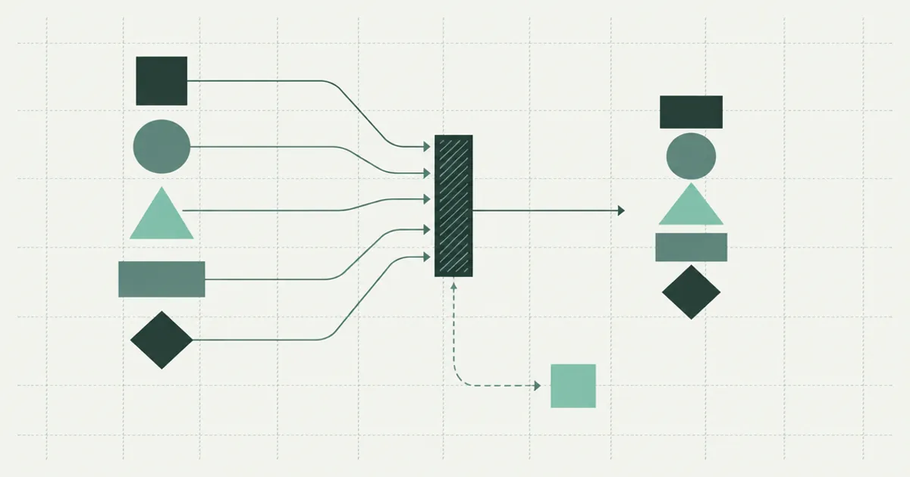

# Validating claims feeds before they hurt you
<!--
Primary: claims feed validation
Secondary: batch reconciliation; rejection handling
Intent: extend a schema contract to whole-feed checks.
-->

!!! warning "Sample post"
    This is a demo post by a fictional sample author. All claims scenarios are invented for demonstration.

Claims feed validation begins with types but quickly reaches questions about the whole delivery. Two individually valid rows may repeat the same claim snapshot. A well-formed policy identifier may refer to a policy absent from the reference extract. These failures need checks beyond a row model.

<!-- more -->

{ width="1200" height="630" }

## Separate row checks from batch reconciliation

Start with mandatory identifiers, parseable dates and permitted currency codes. Preserve the original source values alongside the mapped values in a controlled staging area. If a date parser accepts an ambiguous format, a successful parse can conceal a wrong interpretation.

Then test the batch key. For a snapshot feed, that might be source system, claim identifier and valuation date. Count duplicate keys before removing anything. Some duplicates reflect retransmission; others carry conflicting balances that require the source owner to choose a record.

<figure markdown>
{ loading=lazy width="1200" height="630" }
<figcaption>Conceptual flow: accepted records and exceptions remain separately traceable. This abstract diagram does not encode actual record counts.</figcaption>
</figure>

The [previous part on SQLModel storage](dummy-sqlmodel-policy-table.md) puts uniqueness into a database constraint. A batch check gives a more useful explanation before the database rejects the insert.

## Check policy references at the right date

A claim can legitimately refer to an expired policy. Matching only against today's active policies may therefore create false exceptions. Document which historical policy population should cover the claims, and include effective dates when the relationship requires them.

Unknown references should have counts and monetary totals by currency. One missing high-value claim can matter more than many low-value missing references. Avoid a single pass percentage that hides the distribution.

Use the [policy-query tutorial](../../learn/spacex/creating_policies.md) to practise reading reference rows. Its sample query is a starting point; a real coverage check needs the agreed matching keys and date basis.

## Give rejection handling an owner

A row-level failure can be quarantined if the contract permits partial delivery. A batch-level failure may block publication entirely. Record that policy in configuration or documentation rather than leaving it to the person running the script.

!!! warning "Illustrative threshold"
    A rejection threshold is a business decision. This sample does not recommend an acceptable failure percentage for reserving data.

For every blocked run, produce a short report with the failed rule, affected count and a secure reference to detailed records. Avoid putting names, addresses or claim narratives in ordinary application logs.

## Test the failure path

Build a synthetic fixture containing a duplicated snapshot, an unknown policy and a malformed date. Confirm the expected rule catches each case and that the publication step does not run after a blocking failure. Also test a fully valid batch so an overbroad rule cannot silently stop every delivery.

The [repeatable-pipeline finale](dummy-repeatable-pipeline.md) places these checks before publication. Return to [the reserving-data pillar](dummy-reserving-data.md) when a disagreement concerns meaning rather than code: a validation rule cannot resolve an undefined valuation basis.
