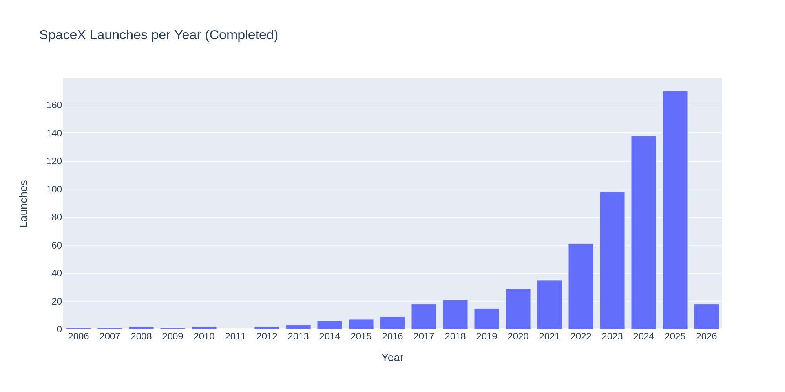
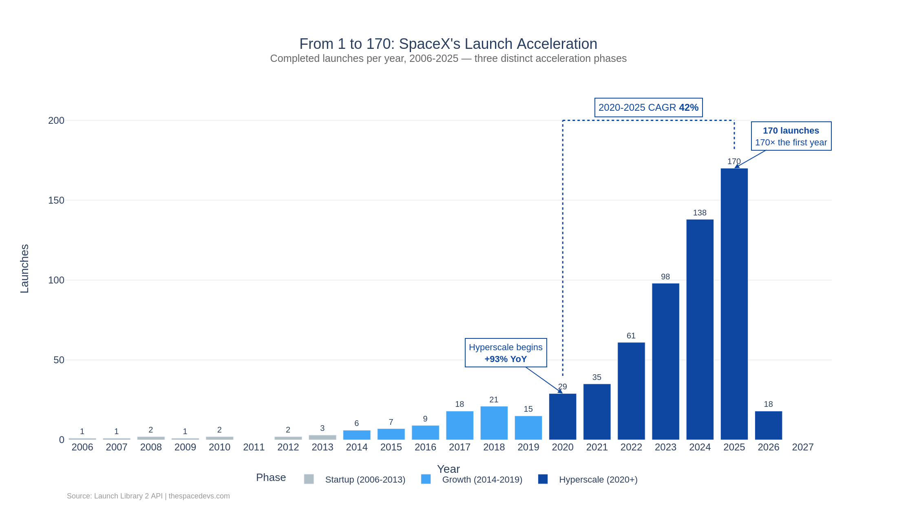

# Loss ratio dashboards in Dash
<!--
Primary: loss ratio dashboards
Secondary: weighted loss ratio; Dash filters
Intent: demonstrate metric definitions alongside interface behaviour.
-->

!!! warning "Sample post"
    This is a demo post by a fictional sample author. The dashboard is a design example, not a deployed insurance application.

Loss ratio dashboards can disagree even when every callback runs successfully. One view may average row percentages while another divides total losses by total earned premium. Define the metric and filter population before building the interface, then make the dashboard's reconciliation easy to inspect.

<!-- more -->

{ width="1200" height="630" }

## Define the weighted loss ratio

For this synthetic example, loss ratio means incurred losses divided by earned premium for the same selected population and period. The choice of gross or net amounts, expenses and valuation basis still needs to be documented.

| Item | Example definition | Review question |
| --- | --- | --- |
| Numerator | Incurred losses | Are expenses included? |
| Denominator | Earned premium | Is the period consistent? |
| Currency | One selected currency | Was conversion applied? |
| Zero denominator | Undefined ratio | How does the interface explain it? |

A ratio of totals weights rows by their denominators. An unweighted average of row ratios generally answers a different question. Keep both amounts visible in a supporting table so reviewers can check the calculation.

## Keep Dash filters consistent

The following alternatives show the metric boundary rather than a complete Dash application. Call one helper from the callback after applying the agreed filters.

=== "Plain Python"

    ```python
    def loss_ratio(rows):
        losses = sum(r["incurred"] for r in rows)
        premium = sum(r["earned"] for r in rows)
        return None if premium == 0 else losses / premium
    ```

=== "Pandas"

    ```python
    def loss_ratio(frame):
        totals = frame[["incurred", "earned"]].sum()
        premium = totals["earned"]
        return None if premium == 0 else totals["incurred"] / premium
    ```

These sketches assume already validated numeric inputs. Pandas summation can skip missing values, so reject or explicitly handle missing amounts before calling the helper. Mixing unknown losses with known premiums can produce a plausible but incomplete result.

!!! tip "Test an empty selection"
    Return a clear no-data state when filters match no rows. Do not display a cached percentage from the previous selection.

## Reference gallery for chart composition

These are existing launch-cadence chart images, not screenshots of a running loss-ratio dashboard. They provide visual references for a raw view and an annotated presentation.

=== "Raw reference"

    <figure markdown>
    { loading=lazy width="2000" height="1000" }
    <figcaption>A raw comparison view can help reviewers inspect the plotted measure.</figcaption>
    </figure>

=== "Composed reference"

    <figure markdown>
    { loading=lazy width="2200" height="1240" }
    <figcaption>An annotated view gives the reader more context without changing the underlying subject.</figcaption>
    </figure>

Follow the [chart-selection sample](dummy-cfo-chart.md) and the [original tutorial](../../learn/spacex/launch_cadence.md) for the before-and-after discussion.

## Test the displayed population

Create synthetic cases with unequal premiums, a zero denominator and a filter that excludes every row. Confirm the numerator and denominator change together. Check that downloading the supporting table preserves the same filters and valuation date as the displayed result.

The [claims-feed checks](dummy-claims-feed-validation.md) belong upstream of these callbacks. A dashboard should expose data-quality status, but it should not quietly repair rejected financial records inside a chart function.
