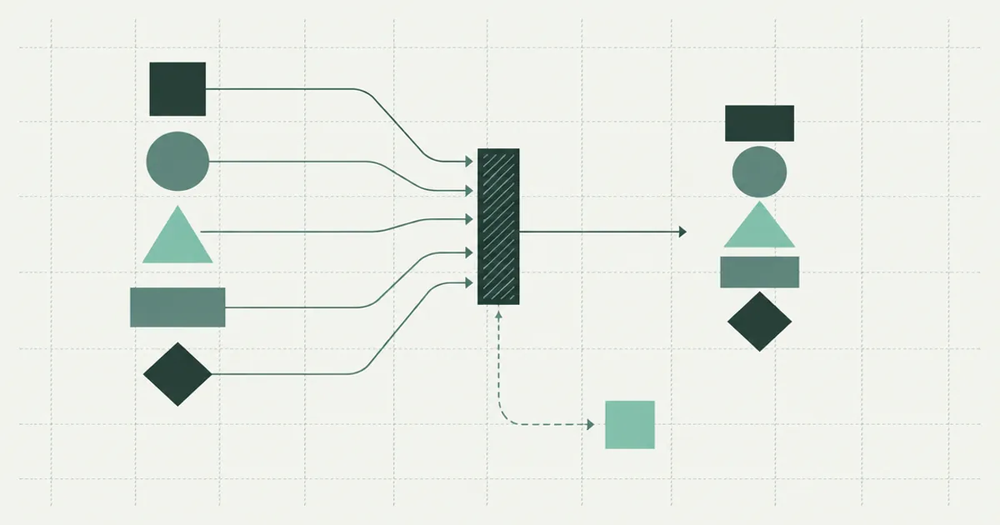

# Shipping the model: a repeatable pipeline
<!--
Primary: repeatable data pipeline
Secondary: safe retries; pipeline handover
Intent: turn the preceding models into an operable delivery.
-->

!!! warning "Sample post"
    This is a demo post by a fictional sample author. The operating procedure is illustrative and needs adaptation before real use.

A repeatable data pipeline should let another person answer what ran, which input it used and why its output was published. The model and validation rules from this series provide the checks. A run record and a controlled publication step make those checks useful during a failed delivery.

<!-- more -->

{ width="1200" height="630" }

## Record the run before transforming data

Assign a run identifier and record the source checksum, extraction time, valuation date and code version. Include the schema version and relevant configuration. A filename is insufficient when a supplier overwrites yesterday's file with corrected contents.

Keep raw input immutable in an access-controlled location. If retention rules prohibit keeping the full file, document the approved alternative and what it means for reproducibility. A checksum can identify a file, but it cannot reconstruct missing contents.

The [SpaceX tutorial](../../learn/data/spacex.md) separates extraction, mapping and orchestration. Follow that separation in a small insurance example so a parsing change can be tested without making another network request.

## Put publication after reconciliation

Run field validation, batch checks and reference matching before exposing a new output. The [claims-feed validation part](dummy-claims-feed-validation.md) explains why some failures should block the whole delivery.

Write accepted data into a staging destination. Compare counts and amounts, then publish through a mechanism appropriate to the destination: a database transaction, a versioned object pointer or a same-filesystem atomic rename. These mechanisms have different guarantees, so test the actual storage system.

<figure markdown>
{ loading=lazy width="1200" height="630" }
<figcaption>Publication follows the checked path; exception records stay attached to the run for review.</figcaption>
</figure>

## Design safe retries

Distinguish an identical replay from a correction. An identical replay should not add duplicate policies or claims. A corrected file needs a new version or a documented replacement procedure, even if its filename and valuation date match an earlier delivery.

Simulate a failure after staging but before publication. Restart the run and verify that readers still see the last complete output until the replacement is ready. Also test failure immediately after publication: the runner may report an error even though the output became visible.

Keep success detection separate from notification. Retrying a failed email should not reload the database. A notification can reference the completed run identifier and be retried independently.

## Write a pipeline handover that can be used

List the normal command, required environment variables and expected output locations. Do not include credentials in the document. Describe how to inspect a failed rule and who can approve a controlled exception.

A useful exercise is to give a colleague only the handover and a synthetic broken file. Ask them to locate the failed record and recover without editing source data by hand. Any undocumented step they need belongs in the procedure or in the program.

This closes the series; start again at [the Pydantic input model](dummy-pydantic-actuaries.md) when changing fields. The [reserving-data pillar](dummy-reserving-data.md) remains the place to review row meaning before expanding the pipeline to another source.
